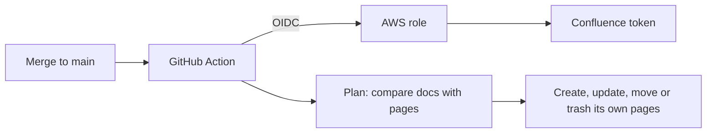

# How publishing works

## Which pages it changes

The publisher only changes pages it created, plus the root page.

- Each page it creates carries a hidden content property
  (`confluence-publish`) naming the repo and file. Only pages with this repo's
  property are ever updated, moved or trashed.
- Every other page is left alone, whether it's under the root page or not.
- If a doc's title is already used by a page it didn't create, anywhere in the
  space, the run fails before changing anything. The error names the page and
  says how to fix it.
- The root page takes the docs folder's `README.md`. If the root page has
  hand-written content, `adopt-root` (on by default) replaces it once. A root
  page that another repo publishes into is always refused.

## On each publish

1. **Plan.** It reads the docs and the pages under the root page, and works
   out what to create, update, move or trash. Any problem (a title clash, a
   broken link, a diagram that won't render) fails the run here, before
   anything is written.
2. **Apply.** It makes the changes, one page at a time.

- **Unchanged pages aren't saved again,** so page history only shows real
  changes. Their images are still checked, and put back if someone removed
  them.
- **Moving or renaming a file keeps the same page,** with the same ID and URL,
  as long as its title stays the same. Links and comments keep working.
- **Deleting a file trashes its page** (`on-orphan: delete`), where it can be
  restored. If pages the publisher didn't create sit under it, it keeps the
  page instead, so they aren't trashed with it.
- **Every change is a page version** by the service account, with a note
  naming the repo and commit ("Published from stellar/horizon@abc123").

## Edits made in Confluence

Each published page starts with a note linking to its source file. Pages the
publisher creates are restricted so only the `confluence-docs-publishers`
group can edit them. Anyone who can see the space can still read and comment
on them.

Until the service account is allowed to set restrictions, pages stay open,
and the run warns about it. Later runs try again. Space admins can always
edit a page. An edit made in Confluence lasts until the doc next changes in
GitHub, and is then overwritten.

## If a run fails part way

Each page is marked as done only after it's fully written, so the next run
picks up where the last one stopped. Nothing is duplicated.

Creating a page and marking it as the publisher's are two separate requests.
If a run stops between them, the next run recognises the page as its own and
marks it: it's under the root page, nobody has edited it since, and its note
links to that doc's source file. Any other unmarked page with the same title is
refused, as usual.
