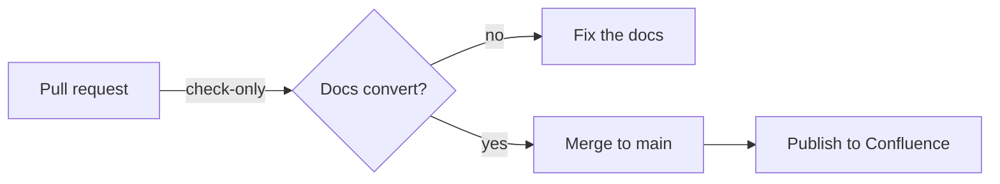
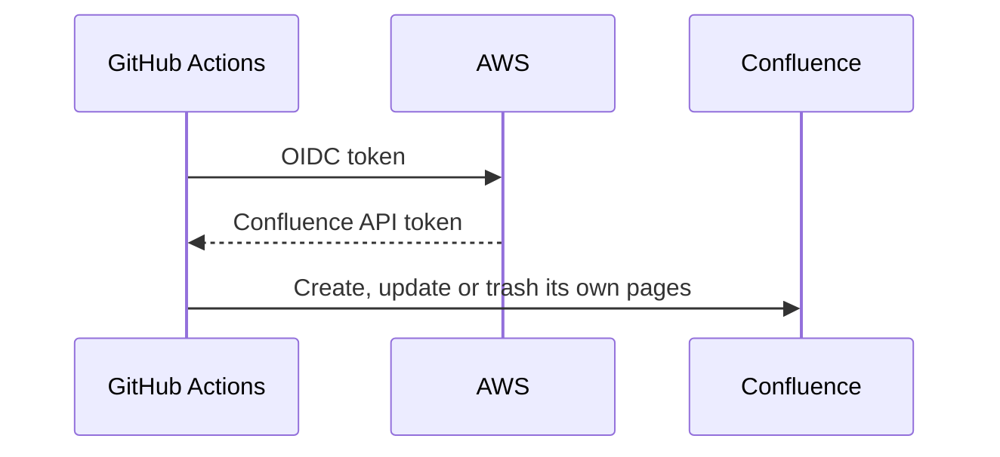

# Rendering examples

This page is a Markdown file in GitHub, published as it is. Open its source
file (linked at the top) next to it to compare.

## Text

Plain text with **bold**, *italic*, ~~strikethrough~~ and `inline code`.

A bare address like https://developers.stellar.org becomes a link, and so does
an email address: sre@stellar.org. File names such as `README.md` or
setup.py stay plain text.

> A blockquote, for notes and warnings that should stand out.

## Lists

- Bullets
  - can nest
  - as deep as you need
- and carry on

1. Numbered steps
2. stay numbered
3. in order

## Links

- To another doc: [Writing docs](writing-docs.md)
- To a heading in another doc: [how titles work](writing-docs.md#titles)
- To a heading on this page: [the diagrams below](#diagrams)
- To a file in the repo that isn't a doc, which links to it on GitHub:
  [the action's definition](../action.yml)
- To a website: [Stellar](https://stellar.org)

## Tables

| Input | Default | What it does |
| --- | --- | --- |
| `folder` | `confluence` | Folder of Markdown to publish |
| `title-prefix` | `""` | Goes in front of every page title |
| `dry-run` | `false` | Shows the plan, changes nothing |

## Code

Each block keeps its language for highlighting:

```bash
uv run confluence-publish confluence --check
```

```yaml
- uses: stellar/actions/confluence-publish@main
  with:
    folder: confluence
    root-page: "<root page id>"
```

```python
def hello(name: str) -> str:
    return f"Hello, {name}"
```

A language Confluence doesn't know, like HCL, is shown as plain text:

```hcl
resource "aws_iam_role" "example" {
  name = "example"
}
```

## Diagrams

Fenced `mermaid` blocks are drawn as images when the docs are published. The
diagram's source stays in Git.





## Images

Images are uploaded as attachments to the page:


## What doesn't render

These are shown as written, on purpose:

- Raw HTML, like <br> or <details>, appears as text. Docs can't inject HTML or
  Confluence macros.
- Task lists show their brackets: [ ] not done, [x] done.
- `www.example.com` without `https://` isn't turned into a link.
