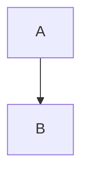

# Setup guide (docs-publisher test)

## Install

| Step | Command |
| --- | --- |
| 1 | `uv sync` |

## Run the tests

```sh
uv run pytest -q
```

Back to [getting started](../getting-started.md). External: [Atlassian](https://www.atlassian.com).


